<div dir="rtl">

# درع — منصة ذكية لتقييم الجاهزية السيبرانية للشركات الصغيرة والمتوسطة

**Design and Implementation of a Smart Cybersecurity Readiness Assessment Platform for Small and Medium Enterprises (SMEs)**

مشروع تخرج — منصة ويب تقيس جاهزية الشركات الصغيرة والمتوسطة للأمن السيبراني اعتماداً على إطار **NIST Cybersecurity Framework (CSF) 2.0**، عبر استبيان ديناميكي يتكيّف مع إجابات المستخدم، وتُخرج **درجة ومستوى نضج** لكل وظيفة، مع **خطة عمل عملية مرتبة حسب الأولوية** — لا مجرد وصف لمستوى النضج.


<p align="center">
  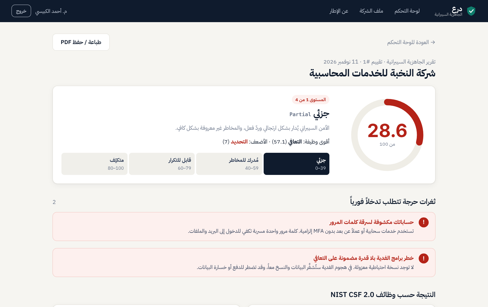
</p>

---

## المحتويات

1. [المشكلة](#1-المشكلة)
2. [الهدف](#2-الهدف)
3. [ما الذي يجعل المنصة "ذكية"؟](#3-ما-الذي-يجعل-المنصة-ذكية)
4. [التشغيل السريع](#4-التشغيل-السريع)
5. [جولة مصورة في المنصة](#5-جولة-مصورة-في-المنصة)
6. [المعمارية وهيكل المشروع](#6-المعمارية-وهيكل-المشروع)
7. [قاعدة البيانات](#7-قاعدة-البيانات)
8. [نموذج التقييم وبنك الأسئلة](#8-نموذج-التقييم-وبنك-الأسئلة)
9. [خوارزمية التقييم](#9-خوارزمية-التقييم)
10. [محرك التوصيات](#10-محرك-التوصيات)
11. [واجهة برمجة التطبيقات API](#11-واجهة-برمجة-التطبيقات-api)
12. [الاختبار والتقييم](#12-الاختبار-والتقييم)
13. [دراسة الحالة](#13-دراسة-الحالة)
14. [الأمان في المنصة نفسها](#14-الأمان-في-المنصة-نفسها)
15. [القيود والتطوير المستقبلي](#15-القيود-والتطوير-المستقبلي)

📄 **وثيقة المشرف:** [docs/SUPERVISOR_REPORT.md](docs/SUPERVISOR_REPORT.md) — 🎤 **نص العرض (3 دقائق لشخصين):** [docs/PRESENTATION_SCRIPT.md](docs/PRESENTATION_SCRIPT.md) — 📑 **تقرير نموذجي PDF:** [docs/sample-report.pdf](docs/sample-report.pdf)

---

## 1. المشكلة

تعتمد الشركات الصغيرة والمتوسطة (SMEs) بشكل متزايد على التقنيات الرقمية، لكنها تظل عرضة للهجمات السيبرانية بسبب محدودية مواردها وخبراتها. الأطر الحالية لقياس الجاهزية (مثل NIST CSF وISO 27001) مصممة غالباً للمؤسسات الكبيرة، فهي معقدة ومكلفة وتتجاوز قدرات الشركات الصغيرة. مدراء هذه الشركات يحتاجون إلى **إرشادات عملية قابلة للتنفيذ** بدلاً من وصف لمستوى نضجهم، كما أن معظم أدوات التقييم **ثابتة** لا تتكيف مع طبيعة الشركة ولا تعكس المخاطر المتغيرة.

## 2. الهدف

تصميم وتنفيذ منصة تقييم ذكية تكون:

| المتطلب | كيف تحقق في المنصة |
|---|---|
| **سهلة الاستخدام** | سؤال واحد في كل شاشة، لغة عربية بسيطة، شرح "لماذا نسأل؟" لكل سؤال، تعمل على الهاتف |
| **تفاعلية وذكية** | استبيان ديناميكي بمنطق تخطٍّ، أوزان تتكيف مع ملف الشركة، كشف ثغرات مركّبة |
| **قابلة للتنفيذ** | 58 توصية في قاعدة المعرفة، مرتبة حسب الأولوية والأثر، مع خطة 7/30/90 يوماً والمكسب المتوقع لكل خطوة |
| **معتمدة على إطار معروف** | كل سؤال مربوط بفئة محددة في NIST CSF 2.0 (مثل `PR.AA-03`)، والمستويات مستوحاة من Tiers الإطار |

## 3. ما الذي يجعل المنصة "ذكية"؟

1. **منطق التخطي (Skip Logic)** — نوعان من التخطي:
   - **غير منطبق (N/A):** شركة لا تستخدم السحابة لا تُسأل عن أمان السحابة، ويُستبعد السؤال من الحساب فلا يظلمها.
   - **متطلب مفقود (Zero):** إذا أجاب المستخدم "لا يوجد مسؤول عن الأمن"، لا نسأله عن السياسات بالتفصيل، بل ننتقل للتوصية بتعيين مسؤول أولاً — وتُحسب هذه الضوابط صفراً لأنها غير موجودة فعلياً.
   - التخطي **متسلسل**: إذا تُخطّي سؤال، تُتخطى الأسئلة المعتمدة عليه تلقائياً.
2. **أوزان متكيّفة مع المخاطر:** لكل سؤال وزن أساسي (1–5)، ويرفعه المحرك حسب ملف الشركة؛ مثلاً قطاع الصحة/المالية يرفع وزن حماية البيانات ×1.5، والعمل عن بعد يرفع وزن التحكم بالوصول ×1.25 — ويُعرض سبب الرفع للمستخدم.
3. **كاشف الثغرات المركّبة:** قواعد تجمع أكثر من إجابة لاكتشاف سيناريو هجوم حقيقي، مثل: "عمل عن بعد + MFA غير إلزامية" ← *حساباتك مكشوفة لسرقة كلمات المرور*.
4. **محرك توصيات بالأولوية والأثر:** يحسب لكل توصية **المكسب المتوقع في الدرجة** إذا نُفذت، ويصنّف المكاسب السريعة (جهد قليل + تكلفة منخفضة + أولوية عالية)، ويتنبأ بالدرجة بعد تنفيذ خطة الأسبوع/الشهر.
5. **تتبع التقدم:** كل تقييم جديد يُقارن بالسابق (لكل وظيفة وللإجمالي) مع رسم تطور عبر الزمن — التقييم ليس لقطة ثابتة.

## 4. التشغيل السريع

**المتطلبات:** Node.js 18 أو أحدث (تم الاختبار على Node 22).

```bash
git clone https://github.com/blackangiliq/issra_project.git
cd issra_project
npm install
npm start
```

افتح المتصفح على: **http://localhost:3000** ثم أنشئ حساباً.

- قاعدة البيانات تُنشأ تلقائياً في `data/cyber.db` وتُعبّأ ببنك الأسئلة وقاعدة المعرفة عند أول تشغيل.
- لتغيير المنفذ أو مسار القاعدة: `PORT=8080 DB_FILE=./my.db npm start`
- في بيئة الإنتاج عيّن مفتاح الجلسة: `SESSION_SECRET=...`

```bash
npm test                 # 15 اختباراً آلياً (المحرك + الـ API)
npm run screenshots      # اختبار الواجهة End-to-End والتقاط الصور (يتطلب Python + Playwright والخادم يعمل)
```

## 5. جولة مصورة في المنصة

> جميع الصور التالية التُقطت آلياً أثناء اختبار الواجهة الكامل (`scripts/screenshots.py`) على دراسة الحالة في القسم 13.

### تسجيل الدخول
صفحة دخول تشرح قيمة المنصة ووظائف NIST الست.

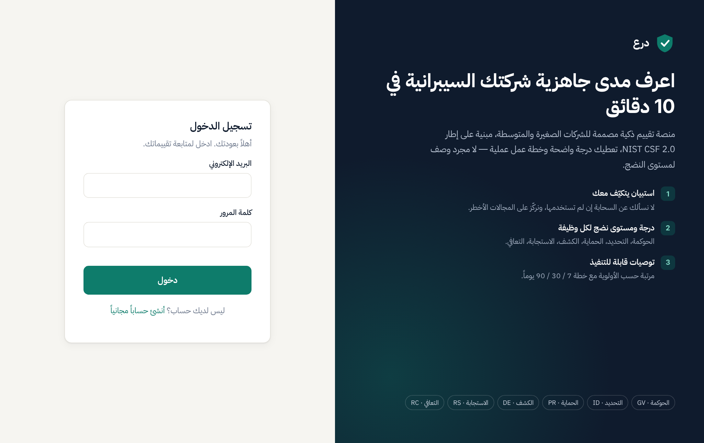

### ملف الشركة
أربعة أسئلة عن طبيعة العمل التقنية تخصّص الاستبيان: ما الأسئلة التي ستظهر، وما الأوزان التي سترتفع.

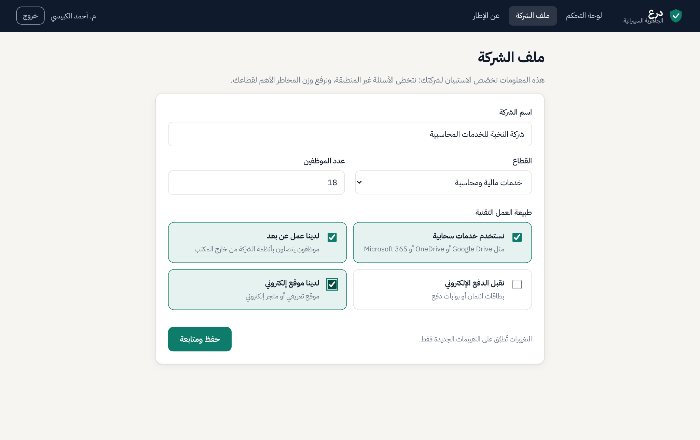

### لوحة التحكم (قبل أول تقييم)
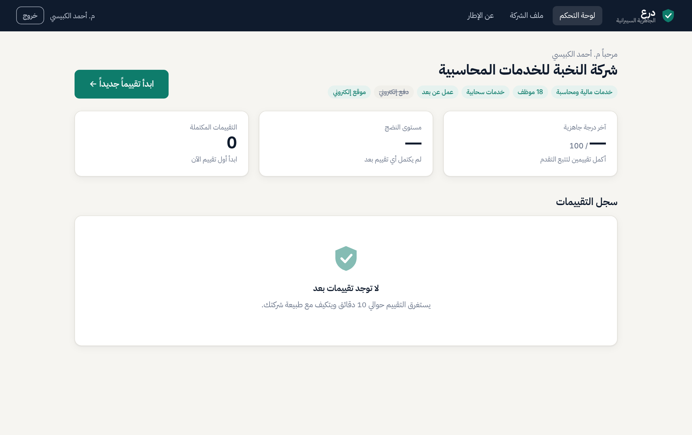

### الاستبيان الديناميكي
سؤال واحد في كل شاشة، مع شريط الوظائف الست، رمز الفئة في NIST CSF 2.0، والوزن المعدّل لهذه الشركة، وشرح "لماذا نسأل؟".

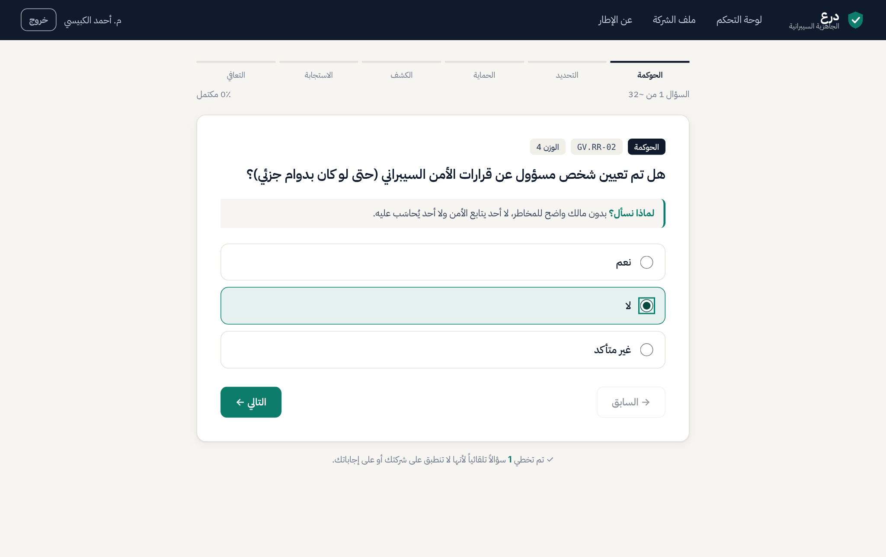

في هذه الصورة: المستخدم أجاب "لا" على وجود مسؤول أمن، فتخطت المنصة **4 أسئلة** تلقائياً (لاحظ الملاحظة أسفل البطاقة)، ووزن MFA ارتفع من 5 إلى **6.3** لأن الشركة لديها عمل عن بعد.

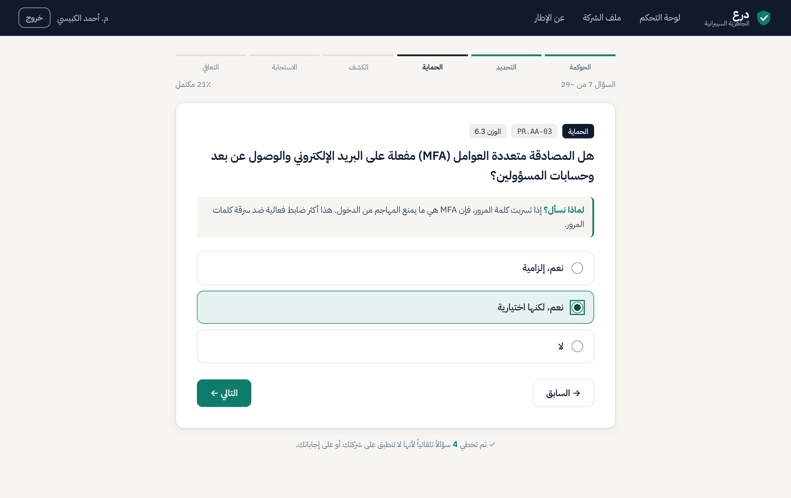

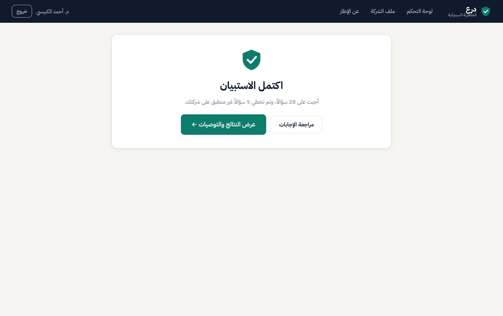

### تقرير الجاهزية
الدرجة الكلية، مستوى النضج على سلّم من 4 مستويات، أقوى وأضعف وظيفة، والثغرات الحرجة المركّبة.


الدرجة لكل وظيفة (رسم راداري + أشرطة) والتنبؤ بالدرجة بعد تنفيذ الخطة:

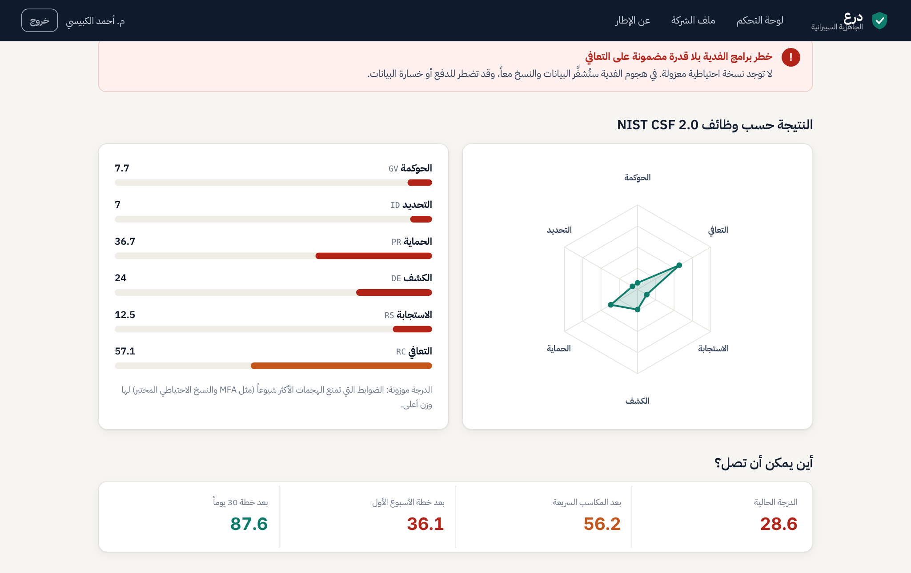

### خطة العمل والتوصيات
كل توصية: أولوية، وظيفة ورمز NIST، جهد، تكلفة، مدة، **مكسب متوقع بالنقاط**، وسبب ارتفاع الوزن، وما الضوابط التي ستفتحها.

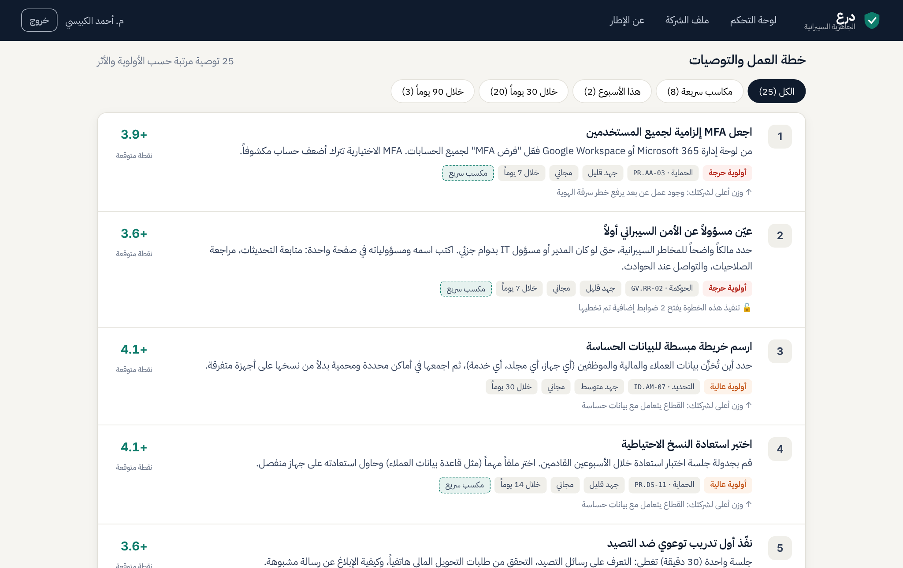

تصفية "المكاسب السريعة":

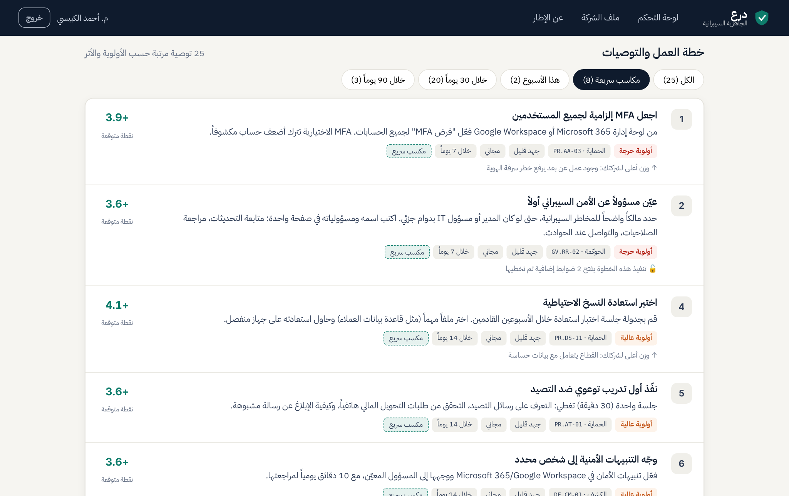

### إعادة التقييم وتتبع التقدم
بعد تنفيذ التوصيات (التقييم الثاني): ارتفعت الدرجة من **28.6** إلى **86.8**، مع إظهار الفرق لكل وظيفة وخط متقطع للتقييم السابق على الرسم الراداري.

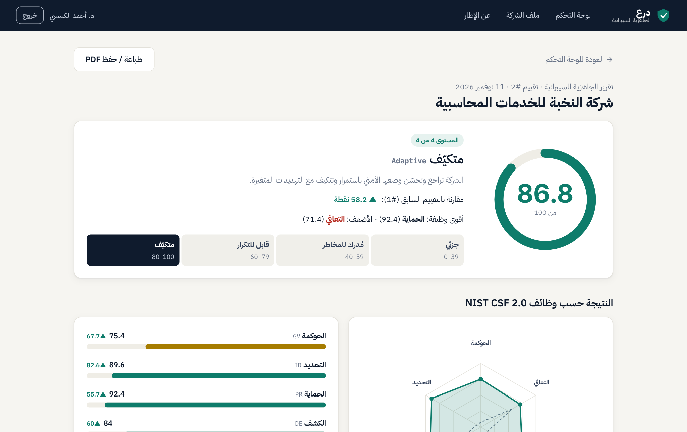

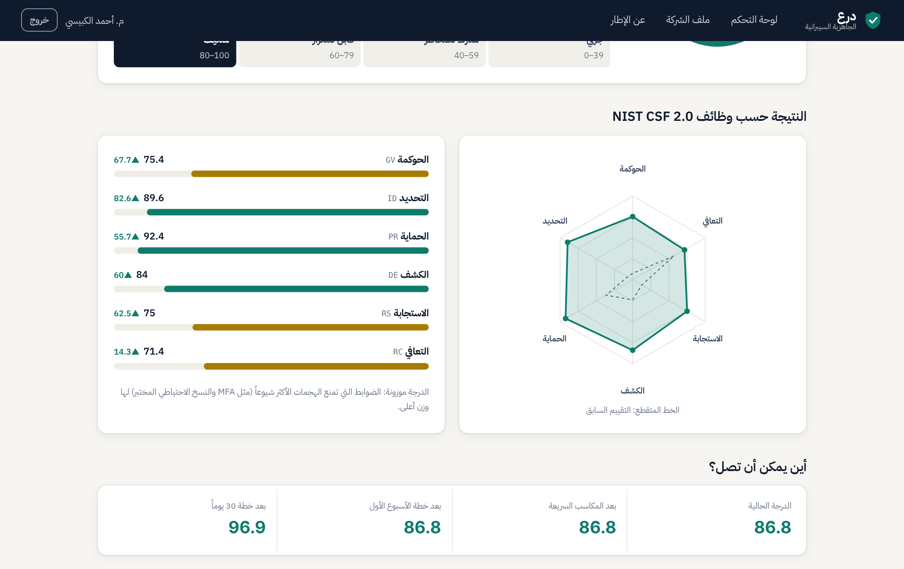

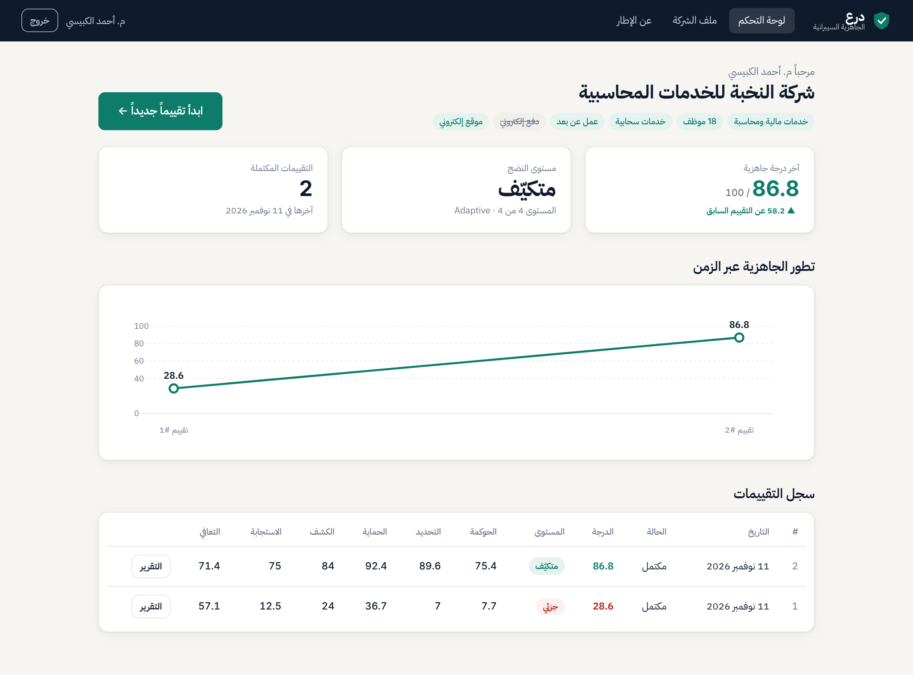

### صفحة المنهجية — والعرض على الهاتف

<p>
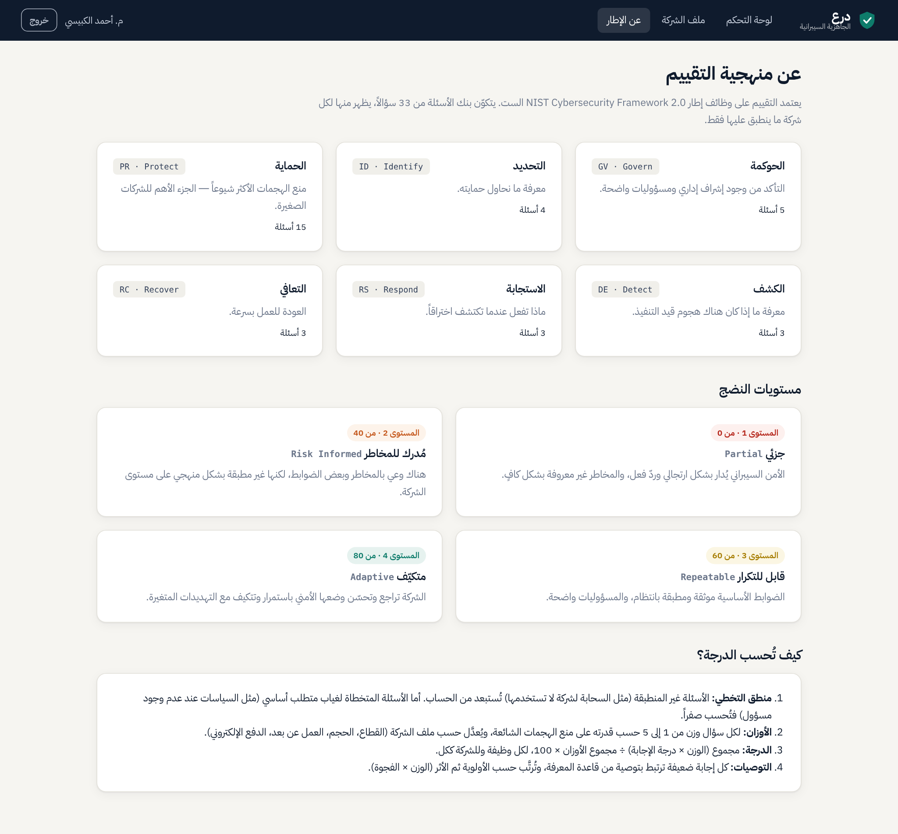
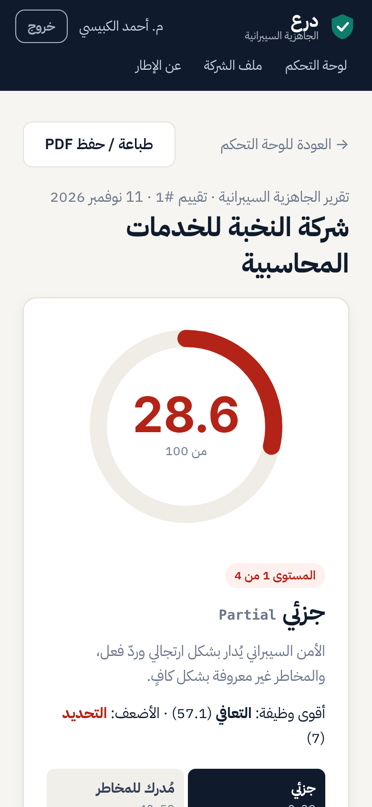
</p>

يمكن طباعة التقرير أو حفظه PDF من زر "طباعة / حفظ PDF" — نموذج: [docs/sample-report.pdf](docs/sample-report.pdf).

## 6. المعمارية وهيكل المشروع

```
┌────────────────────────┐   JSON / REST   ┌─────────────────────────────┐   SQL   ┌──────────────┐
│  الواجهة الأمامية       │ ───────────────▶│  Express API  (src/app.js)  │───────▶│   SQLite     │
│  HTML + CSS + JS (RTL)  │◀─────────────── │  مصادقة · تحقق · صلاحيات     │◀───────│ data/cyber.db│
└────────────────────────┘                 └──────────────┬──────────────┘        └──────────────┘
                                                          │ يستدعي
                                           ┌──────────────▼──────────────┐
                                           │  المحرك الذكي (src/engine.js) │
                                           │  تخطٍّ · أوزان · درجة ·        │
                                           │  ثغرات مركبة · توصيات          │
                                           └─────────────────────────────┘
```

المحرك **دالّي نقي (Pure)**: يستقبل بنك الأسئلة + ملف الشركة + الإجابات ويعيد النتيجة، دون أي اتصال بقاعدة البيانات — ما جعل اختباره سهلاً ومستقلاً.

```
issra_project/
├── server.js                  نقطة التشغيل
├── src/
│   ├── app.js                 واجهة REST API + تقديم الواجهة
│   ├── db.js                  مخطط قاعدة البيانات + التعبئة الأولية
│   ├── engine.js              المحرك الذكي (التخطي، الأوزان، الدرجة، التوصيات)
│   └── data/framework.js      بنك الأسئلة وقاعدة المعرفة (NIST CSF 2.0)
├── public/                    الواجهة الأمامية (SPA بدون أدوات بناء)
│   ├── index.html
│   ├── app.css
│   └── app.js
├── test/
│   ├── engine.test.js         اختبارات وحدة للمحرك (11)
│   └── api.test.js            اختبارات تكامل للـ API (4 سيناريوهات)
├── scripts/
│   ├── screenshots.py         اختبار الواجهة E2E + التقاط الصور + PDF
│   └── case_study.json        بيانات دراسة الحالة
└── docs/
    ├── SUPERVISOR_REPORT.md   وثيقة المشرف
    ├── sample-report.pdf      تقرير نموذجي
    └── screenshots/           صور الشاشة
```

**التقنيات:** Node.js · Express 5 · SQLite (better-sqlite3) · bcryptjs · cookie-session · JavaScript بدون أطر في الواجهة · رسومات SVG مرسومة يدوياً (رادار، مقياس دائري، خط زمني) · خط IBM Plex Sans Arabic محلي (يعمل بدون إنترنت).

## 7. قاعدة البيانات

9 جداول في SQLite. بنك الأسئلة وقاعدة المعرفة **مخزّنان في قاعدة البيانات** (لا في الكود فقط)، ويُحمَّلان منها عند التشغيل.

```
users ──1:1── companies ──1:N── assessments ──1:N── answers ──N:1── questions ──N:1── functions
                                     │                                  │
                                     └──1:N── function_scores           ├──1:N── options
                                                                        └──1:N── recommendations
```

| الجدول | الوصف | أهم الحقول |
|---|---|---|
| `users` | المستخدمون | `email` فريد، `password_hash` (bcrypt) |
| `companies` | ملف الشركة | `sector`, `employees`, `uses_cloud`, `remote_work`, `card_payments`, `has_website` |
| `functions` | وظائف NIST الست | `code` (GV/ID/PR/DE/RS/RC), `name`, `goal` |
| `questions` | بنك الأسئلة | `nist_ref`, `weight` (1–5), `condition_json` (شرط الظهور), `skip_mode` (na/zero) |
| `options` | خيارات كل سؤال | `score` (0..1، أو NULL = غير منطبق) |
| `recommendations` | قاعدة المعرفة | `option_value` → `title`, `action`, `priority`, `effort`, `cost`, `days` |
| `assessments` | التقييمات | `status`, `profile_snapshot` (نسخة ملف الشركة وقت التقييم), `overall_score`, `tier` |
| `answers` | الإجابات | مفتاح مركب (`assessment_id`, `question_id`) |
| `function_scores` | درجات الوظائف المحفوظة | لعرض السجل والمقارنة بسرعة |

حفظ `profile_snapshot` يضمن أن تعديل ملف الشركة لاحقاً لا يغيّر نتائج التقييمات القديمة.

## 8. نموذج التقييم وبنك الأسئلة

**33 سؤالاً** موزعة على وظائف NIST CSF 2.0 الست، يظهر منها لكل شركة ما ينطبق عليها فقط (28–32 سؤالاً عادةً). الأسئلة العشرة المقترحة في خطة المشروع موجودة كما هي، ووُسّعت بأسئلة إضافية.

| الوظيفة | عدد الأسئلة | أمثلة | الفئات |
|---|---|---|---|
| **الحوكمة GV** | 5 | مسؤول الأمن، السياسات المكتوبة، الميزانية، أمن الموردين | GV.RR, GV.PO, GV.RM, GV.SC |
| **التحديد ID** | 4 | جرد الأجهزة، جرد الخدمات، خريطة البيانات الحساسة، تقييم المخاطر | ID.AM, ID.RA |
| **الحماية PR** | 15 | MFA، قطع وصول المغادرين، صلاحيات المدير، النسخ الاحتياطي المختبر والمعزول، التحديثات، التوعية، التشفير، السحابة، الوصول عن بعد، الدفع، الموقع | PR.AA, PR.DS, PR.PS, PR.AT, PR.IR |
| **الكشف DE** | 3 | مراجعة التنبيهات، حفظ السجلات، قناة الإبلاغ | DE.CM, DE.AE |
| **الاستجابة RS** | 3 | خطة الاستجابة والتدريب عليها، صلاحية العزل، قائمة الطوارئ | RS.MA, RS.CO |
| **التعافي RC** | 3 | العمليات الحرجة (Business Stoppers)، RTO، التواصل مع العملاء | RC.RP, RC.CO |

الحماية أخذت النصيب الأكبر عمداً، لأنها "الجزء الأهم للشركات الصغيرة" كما في خطة المشروع.

**قواعد التخطي المطبقة:**

| السؤال | يظهر عندما | عند التخطي |
|---|---|---|
| GV-2 السياسات، GV-4 الميزانية | GV-1 (وجود مسؤول) ≠ "لا" | يُحسب صفراً |
| GV-3 توقيع السياسات | GV-2 = موجودة | يُحسب صفراً (تسلسلي) |
| PR-6 النسخة المعزولة | PR-5 = توجد نسخ احتياطية | يُحسب صفراً |
| PR-12 أمان السحابة | الشركة تستخدم السحابة | يُستبعد |
| PR-13 الوصول عن بعد | يوجد عمل عن بعد | يُستبعد |
| PR-14 بيانات البطاقات | تقبل الدفع الإلكتروني | يُستبعد |
| PR-15 أمان الموقع | لديها موقع | يُستبعد |
| RS-2 صلاحية العزل | توجد خطة استجابة | يُحسب صفراً |
| RC-2 هدف RTO | العمليات الحرجة معروفة | يُحسب صفراً |

## 9. خوارزمية التقييم

لكل سؤال *i* مُدرج في الحساب: وزن معدّل *wᵢ* ودرجة إجابة *sᵢ* ∈ [0, 1].

```
w_i = الوزن الأساسي × معاملات ملف الشركة

درجة الوظيفة f = Σ(w_i × s_i) / Σ(w_i) × 100      (لأسئلة الوظيفة f)
الدرجة الكلية   = Σ(w_i × s_i) / Σ(w_i) × 100      (لكل الأسئلة)
```

- خيار "غير منطبق" (مثل "لا توجد شبكة ضيوف") وأسئلة التخطي من نوع N/A **تُستبعد** من البسط والمقام.
- أسئلة التخطي من نوع Zero تدخل بـ *sᵢ = 0*.
- الإجابات الجزئية تأخذ قيماً وسطى (مثلاً MFA اختيارية = 0.3، نسخ احتياطي غير مختبر = 0.4)، و"غير متأكد" = 0.2 لأن عدم المعرفة بحد ذاته ضعف.

**الأوزان:** MFA (PR-1) والنسخ الاحتياطي المختبر (PR-5) لهما أعلى وزن (5) لأنهما يمنعان الهجومين الأكثر شيوعاً (سرقة كلمات المرور والفدية).

**معاملات ملف الشركة:**

| الشرط | يطبَّق على | المعامل |
|---|---|---|
| قطاع صحة / مالية / تجارة إلكترونية | حماية البيانات PR.DS + خريطة البيانات ID.AM-07 | ×1.5 |
| يوجد عمل عن بعد | التحكم بالهوية والوصول PR.AA | ×1.25 |
| 50 موظفاً أو أكثر | الحوكمة GV | ×1.25 |
| يقبل الدفع الإلكتروني | الكشف DE | ×1.2 |

**مستويات النضج** (مستوحاة من Tiers في NIST CSF 2.0):

| المستوى | الاسم | الدرجة |
|---|---|---|
| 1 | جزئي — Partial | 0 – 39 |
| 2 | مُدرك للمخاطر — Risk Informed | 40 – 59 |
| 3 | قابل للتكرار — Repeatable | 60 – 79 |
| 4 | متكيّف — Adaptive | 80 – 100 |

## 10. محرك التوصيات

- **قاعدة المعرفة:** 58 توصية، كل إجابة غير كاملة مرتبطة بتوصية عملية محددة (ماذا تفعل، بأي أداة، وخلال كم يوماً). أمثلة من خطة المشروع:
  - MFA غير مفعّلة ← *"قم بتفعيل MFA على البريد الإلكتروني (Microsoft 365 / Google Workspace) أولاً، ثم على حسابات المسؤولين…"*
  - النسخ غير مختبرة ← *"قم بجدولة جلسة اختبار استعادة خلال الأسبوعين القادمين…"*
- **الترتيب:** حسب الأولوية (حرجة > عالية > متوسطة > منخفضة)، ثم حسب **الأثر** = الوزن المعدّل × (1 − درجة الإجابة).
- **المكسب المتوقع:** `gain = w × (1 − s) / Σw × 100` — كم نقطة سترتفع الدرجة الكلية إذا نُفذت التوصية.
- **المكاسب السريعة:** جهد قليل + تكلفة مجانية/منخفضة + أولوية حرجة/عالية.
- **خطة زمنية:** هذا الأسبوع (≤ 7 أيام)، خلال 30 يوماً، خلال 90 يوماً، مع **تنبؤ بالدرجة** بعد كل مرحلة.
- **التوصيات الممهِّدة:** توصية مثل "عيّن مسؤولاً" تُظهر عدد الضوابط التي ستفتحها (التي تم تخطيها بسببها).

**الثغرات الحرجة المركّبة (6 قواعد):** سرقة الهوية (عمل عن بعد/سحابة + MFA غير إلزامية)، الفدية (لا نسخ أو لا نسخة معزولة)، RDP مكشوف، حسابات وأجهزة يتيمة، تخزين بيانات البطاقات، انعدام الرؤية (لا مراقبة ولا سجلات).

## 11. واجهة برمجة التطبيقات API

| الطريقة | المسار | الوصف |
|---|---|---|
| POST | `/api/auth/register` | إنشاء حساب |
| POST | `/api/auth/login` | تسجيل الدخول |
| POST | `/api/auth/logout` | تسجيل الخروج |
| GET | `/api/auth/me` | المستخدم الحالي + ملف الشركة |
| PUT | `/api/company` | إنشاء/تحديث ملف الشركة |
| GET | `/api/framework` | الوظائف، المستويات، إحصاءات بنك الأسئلة |
| GET | `/api/assessments` | سجل التقييمات مع درجات الوظائف |
| POST | `/api/assessments` | بدء تقييم (أو استئناف المفتوح) |
| GET | `/api/assessments/:id/state` | السؤال التالي + التقدم + الأسئلة المتخطاة |
| POST | `/api/assessments/:id/answers` | حفظ إجابة `{questionId, value}` ← يعيد السؤال التالي |
| POST | `/api/assessments/:id/complete` | إنهاء التقييم وحساب الدرجة |
| GET | `/api/assessments/:id/report` | التقرير الكامل: الدرجات، الثغرات، التوصيات، الخطة، المقارنة |
| DELETE | `/api/assessments/:id` | حذف تقييم |

مثال:

```bash
curl -X POST localhost:3000/api/assessments/1/answers \
  -H 'Content-Type: application/json' -b cookies.txt \
  -d '{"questionId":"PR-1","value":"no"}'
```

## 12. الاختبار والتقييم

### الاختبار الوظيفي الآلي — `npm test`

```
✔ الحماية: الوصول بدون تسجيل دخول مرفوض
✔ التسجيل: يرفض كلمة مرور قصيرة
✔ سيناريو كامل: تسجيل ← ملف شركة ← استبيان ديناميكي ← تقرير
✔ العزل: مستخدم آخر لا يرى تقييمات غيره
✔ بنك الأسئلة يُحمَّل من قاعدة البيانات ويغطي الوظائف الست
✔ منطق التخطي: لا يُسأل عن السحابة إذا لم تستخدم الشركة السحابة
✔ منطق التخطي: "لا يوجد مسؤول" يتخطى أسئلة السياسات التفصيلية
✔ التخطي بسبب متطلب مفقود يُحسب صفراً، والتخطي لعدم الانطباق يُستبعد
✔ الدرجات: أفضل إجابات = 100 والمستوى 4، أسوأ إجابات = 0 والمستوى 1
✔ الأوزان: MFA والنسخ الاحتياطي لهما أعلى وزن
✔ الأوزان المتكيفة: قطاع الصحة يرفع وزن حماية البيانات
✔ مستويات النضج حسب الحدود
✔ محرك التوصيات: كل إجابة سلبية لها توصية، و MFA تأتي حرجة في المقدمة
✔ التوصية بتعيين مسؤول تشير إلى الأسئلة التي ستفتحها
✔ الثغرات الحرجة المركبة: عمل عن بعد بدون MFA + لا نسخ احتياطي
ℹ tests 15 · pass 15 · fail 0
```

اختبارات الـ API تشمل أيضاً: رفض الإجابات غير الصالحة، رفض الإجابة على سؤال غير منطبق، رفض إنهاء تقييم غير مكتمل، ورفض بدء تقييم قبل ملف الشركة.

> **ملاحظة من مرحلة الاختبار:** كشفت الاختبارات خطأً حقيقياً في الإصدار الأول — السؤال المعتمد على سؤال متخطّى (GV-3 ← GV-2 ← GV-1) كان يبقى "معلّقاً" بدل أن يُتخطى. تم إصلاحه بجعل التخطي متسلسلاً، ويغطيه الآن اختبار دائم.

### اختبار الواجهة End-to-End — `scripts/screenshots.py`
سكربت Playwright يقود متصفح Chrome حقيقي عبر المسار الكامل (تسجيل ← ملف الشركة ← استبيانان ← تقريران ← لوحة التحكم ← الهاتف ← PDF)، ويتحقق من أن منطق التخطي يعمل في الواجهة، ويفشل إذا ظهر أي خطأ JavaScript في المتصفح. النتيجة: **اكتمل بدون أخطاء**، وكل الصور في هذا الملف ناتجة عنه.

### اختبار قابلية الاستخدام
المنصة جاهزة لعرضها على مستخدمين من خارج التخصص؛ يُقترح نموذج **SUS (System Usability Scale)** — انظر وثيقة المشرف.

## 13. دراسة الحالة

**شركة افتراضية:** "شركة النخبة للخدمات المحاسبية" — قطاع مالي، 18 موظفاً، تستخدم السحابة، لديها عمل عن بعد وموقع إلكتروني، لا تقبل الدفع الإلكتروني. (الإجابات الكاملة في `scripts/case_study.json`)

| | التقييم الأول | التقييم الثاني (بعد تنفيذ الخطة) |
|---|---|---|
| **الدرجة الكلية** | **28.6** | **86.8** (+58.2) |
| **مستوى النضج** | 1 — جزئي | 4 — متكيّف |
| الحوكمة GV | 7.7 | 75.4 |
| التحديد ID | 7.0 | 89.6 |
| الحماية PR | 36.7 | 92.4 |
| الكشف DE | 24.0 | 84.0 |
| الاستجابة RS | 12.5 | 75.0 |
| التعافي RC | 57.1 | 71.4 |
| الأسئلة المعروضة | 28 من 33 | 32 من 33 |
| الأسئلة المتخطاة | 5 (4 لغياب متطلب + 1 غير منطبق) | 1 (غير منطبق) |
| التوصيات | 25 (منها 8 مكاسب سريعة) | 9 |
| الثغرات الحرجة | 2: سرقة الهوية، الفدية | 0 |

**أعلى التوصيات في التقييم الأول:** (1) جعل MFA إلزامية — حرجة، (2) تعيين مسؤول أمن — حرجة وتفتح ضابطين، (3) رسم خريطة البيانات الحساسة — عالية، وزنها مرفوع لأن القطاع مالي، (4) اختبار استعادة النسخ الاحتياطية — عالية.
تنبأت المنصة بأن تنفيذ المكاسب السريعة الثمانية وحدها يرفع الدرجة من 28.6 إلى **56.2**، وتنفيذ خطة الثلاثين يوماً إلى **87.6** — وهو قريب من نتيجة التقييم الثاني الفعلية (86.8).

## 14. الأمان في المنصة نفسها

- كلمات المرور مشفرة بـ **bcrypt** (10 جولات)، ولا تقل عن 8 أحرف.
- جلسات بكوكيز `HttpOnly` و`SameSite=Lax`.
- كل استعلامات SQL **مُهيّأة (Prepared Statements)** — حماية من SQL Injection.
- كل نص من المستخدم يُهرَّب (Escape) قبل عرضه — حماية من XSS.
- عزل البيانات: كل استعلام تقييم مقيد بـ `user_id` الخاص بالجلسة (مختبَر آلياً).
- التحقق من المدخلات على الخادم (قيم الخيارات، انطباق السؤال، حدود الأرقام).

## 15. القيود والتطوير المستقبلي

- الأوزان ومعاملات المخاطر مبنية على الأدبيات وتقدير الخبراء؛ يمكن معايرتها ببيانات حوادث حقيقية أو بطريقة AHP مع خبراء.
- دعم لوحة إدارة لتعديل بنك الأسئلة من الواجهة (حالياً من `src/data/framework.js` أو قاعدة البيانات مباشرة).
- تصدير التوصيات كمهام (Trello/Jira)، وتذكير دوري بإعادة التقييم.
- مقارنة معيارية (Benchmark) مع شركات من نفس القطاع.
- ربط الأسئلة أيضاً بـ CIS Controls v8 IG1.
- دعم اللغة الإنجليزية.

</div>
